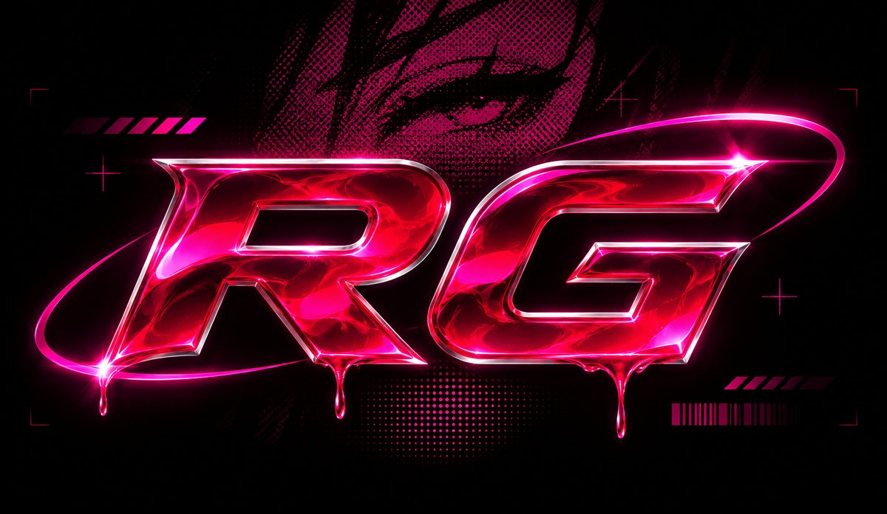

<p align="center"></p>

# aioredgif

**Pull, keep, browse and play RedGIFs creators, niches and tags.** An async FastAPI server with a
neon web app on top: paste a link, everything lands in your library once, and you can play it in the
browser, run it across a multi-screen goon cave, or take it away as a .zip with every tag logged.

> **Adults only.** aioredgif handles explicit content. Run it only where that is legal for you, and
> only keep what you have the right to keep.

## What it does

- **Pull** a creator, niche, tag or single post by pasting its link. Clips download in the background
  at a pace RedGIFs is happy with.
- **Tag filters.** Keep only posts with certain tags, skip posts with others, before anything downloads.
  The same include/exclude chips filter your results, the library, the player and the cave.
- **Never twice.** Every file is stored once in the library. Paste the same link again and only new
  clips download. Different links that share clips reuse them.
- **Pause and resume.** Stop a pull whenever you like and start another. If the server stops mid-pull,
  it picks up on the next start, continuing half-downloaded files from the exact byte.
- **Library.** Browse everything you have ever pulled, across sessions: search, filter by creator, tag
  or type, sort, play, zip. Files you copy into the downloads folder by hand show up too.
- **Player.** Instant in-browser playback with seeking, edge loop, keep going, shuffle, speed, volume
  and full keyboard control.
- **Goon cave.** A wall of 1 to 9 screens of clips, images or both, rotating on a timer, with an edge
  timer that calls holds.
- **Faves and rewards.** Heart clips (they survive restarts); earn ranks for time spent and badges for
  using the features.
- **Metadata.** A JSON sidecar next to every clip, plus `metadata.json` and `tags.json` for each pull.
- **Creator reports.** Profile, profile image, clip and image counts, most used tags, upload timeline,
  views and likes, and download links for every post, as one JSON document.
- **Exports.** The whole library as JSON, JSON Lines or CSV, with the same tag filters.
- **Command line.** `aioredgif pull`, `info`, `export`, `library`, `history` and `resume`, with
  progress bars; Ctrl+C pauses a pull.
- **API.** Everything the page does is a documented HTTP endpoint.

## Install

aioredgif installs straight from GitHub; it is not on PyPI. Replace `OWNER` with the account or
organisation that hosts the repository.

```bash
python -m venv .venv && source .venv/bin/activate      # Windows: .venv\Scripts\activate
pip install "aioredgif @ git+https://github.com/OWNER/aioredgif.git"
```

| To | Use |
|---|---|
| Pin a release | `pip install "aioredgif @ git+https://github.com/OWNER/aioredgif.git@v1.0.0"` |
| Add the Playwright fallback | `pip install "aioredgif[browser] @ git+https://github.com/OWNER/aioredgif.git"` |
| Depend on it from another project | `aioredgif @ git+https://github.com/OWNER/aioredgif.git@v1.0.0` in `requirements.txt` or `pyproject.toml` |
| Upgrade | `pip install --upgrade --force-reinstall "aioredgif @ git+https://github.com/OWNER/aioredgif.git"` |
| Work on the code | `git clone https://github.com/OWNER/aioredgif.git && cd aioredgif && pip install -e ".[dev]"` |

A private repository works the same way with SSH: `git+ssh://git@github.com/OWNER/aioredgif.git`.

## Quick start

```bash
aioredgif                                              # the web app; or: python -m aioredgif
```

Open http://127.0.0.1:8000/ and paste a link such as `https://www.redgifs.com/users/<name>`.
Interactive API docs are at http://127.0.0.1:8000/docs.

From the terminal:

```bash
aioredgif pull https://www.redgifs.com/users/<name> --exclude pov --zip name.zip
aioredgif info @<name>                     # profile, top tags, upload timeline
aioredgif info @<name> --json > name.json  # every field, for your own tools
aioredgif export --format csv --out library.csv
aioredgif history                          # every pull; "aioredgif resume <id>" carries one on
```

Optional browser fallback (used only when the API route fails):

```bash
pip install "aioredgif[browser] @ git+https://github.com/OWNER/aioredgif.git" && playwright install chromium
```

With Docker:

```bash
docker build -t aioredgif .
docker run -p 8000:8000 -v "$PWD/downloads:/app/downloads" aioredgif
```

## Documentation

| Read this | If you want to |
|---|---|
| [User guide](docs/USER_GUIDE.md) | Use the web app: pulling, pausing, the library, player, cave, faves, rewards, where your files and data are |
| [Command line](docs/CLI.md) | Pull, inspect creators and export data from a terminal or script |
| [Data guide](docs/DATA.md) | Know every field in creator reports, exports and sidecars, and how to get them |
| [API reference](docs/API.md) | Call the HTTP API from your own code, with curl examples for every endpoint |
| [Developer guide](docs/DEVELOPING.md) | Understand the code, run the tests, add features |
| [Changelog](CHANGELOG.md) | See what changed between versions |

## Configuration

Set any of these as environment variables or in a `.env` file (see `.env.example`).

| Variable | Default | What it does |
|---|---|---|
| `AIOREDGIF_DOWNLOAD_DIR` | `downloads` | Where the library, metadata, history, faves and profiles live |
| `AIOREDGIF_UPSTREAM_CONCURRENCY` | `4` | Most RedGIFs requests in flight at once (shared by all users) |
| `AIOREDGIF_UPSTREAM_MIN_INTERVAL` | `0.35` | Seconds between the starts of two RedGIFs requests |
| `AIOREDGIF_DOWNLOAD_CONCURRENCY` | `3` | Most files downloading at once |
| `AIOREDGIF_AUTO_RESUME` | `true` | Continue interrupted pulls when the server starts |
| `AIOREDGIF_LIBRARY_RESCAN_SECONDS` | `30` | How often the library looks for files copied in by hand |
| `AIOREDGIF_FREE_RPM` | `30` | Requests per minute for clients without an API key |
| `AIOREDGIF_FREE_MAX_ITEMS_PER_JOB` | `100` | Most clips a free client may pull per job |
| `AIOREDGIF_API_KEYS` | (empty) | Comma separated keys that skip the free-tier limits (`X-API-Key` header) |
| `AIOREDGIF_BROWSER_ENABLED` | `true` | Allow the Playwright fallback |

## Project layout

```
aioredgif/
  app.py          app factory and startup/shutdown
  config.py       settings
  client.py       RedGIFs API client (throttling, retries, sort-order fallback)
  downloader.py   pulls: collect, download, resume, pause, history
  library.py      the library index (picks up hand-copied and older files)
  metadata.py     JSON sidecars, metadata.json, tags.json
  faves.py        faves storage
  rewards.py      ranks and badges
  thumbs.py       thumbnail cache
  parsing.py      RedGIFs links and saved pages to post ids
  browser.py      Playwright fallback
  ratelimit.py    free-tier limits
  api/            HTTP routers, one per area
  static/         the web app (HTML, CSS, JS, fonts, images)
tests/            pytest suite with a fake RedGIFs
docs/             user, API and developer guides
```

## Being a good guest

aioredgif talks to RedGIFs the way a polite browser would: one real temporary token, a fixed
User-Agent, a shared throttle, and backing off when asked (it honours `Retry-After`). It does not
spoof fingerprints, rotate proxies or farm tokens. If you need more throughput, cache results and talk
to RedGIFs about access rather than hiding traffic.

## Legal

- RedGIFs is a trademark of its owner. aioredgif is an independent tool unless and until its owner
  says otherwise, and the RG artwork in `aioredgif/static/img` is aioredgif's own.
- Content belongs to its creators. Respect the RedGIFs Terms of Service, DMCA and Take It Down
  requests: delete files and their metadata when asked. Don't publicly re-host what you download.
- The Archivo font is bundled under the SIL Open Font License (`aioredgif/static/fonts/OFL-LICENSE.txt`).

## License

MIT. See [LICENSE](LICENSE).
